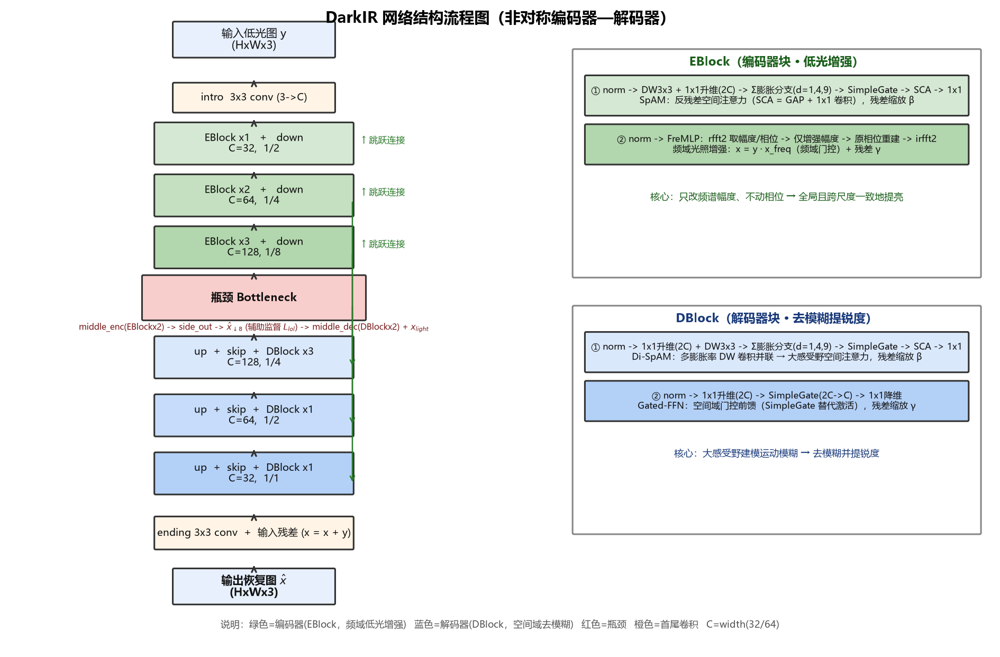
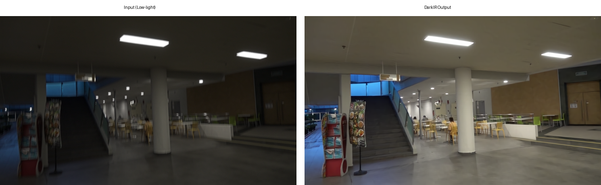
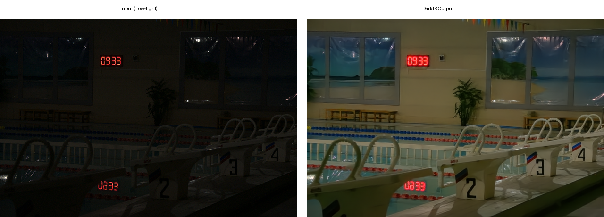

# DarkIR 代码详细解析报告（组员 3 / 工作流程 3）

> 论文：**DarkIR: Robust Low-Light Image Restoration**（CVPR 2025）
> 官方仓库：https://github.com/cidautai/DarkIR
> 本地复现路径：`d:\Dark\DarkIR`
> 负责内容：工作流程 3 —— 结合代码把方法读明白，给出代码的具体解析。

---

## 0. 这份报告解决什么问题

工作流程 3 的目标不是“把模型跑起来出一张图”（那是工作流程 2），而是回答 **“为什么这个模型能恢复低光图像”**。具体要交付三样东西：

1. 一张带中文解释的网络流程图；
2. 关键模块与代码文件的对应关系；
3. 每个关键设计的原理解释（能回答老师的追问）。

本报告在官方代码层面逐模块拆解，并把论文中的结构图、公式与实际代码一一对应，最后附上我们自己复现得到的实验结果。

---

## 1. 论文方法速览（问题—方法—结果）

### 1.1 问题
夜间/弱光照片通常**同时**存在三种退化：亮度不足、传感器噪声、运动模糊。成像模型可写为：

$$y = \gamma(x \otimes k) + n$$

其中 $y$ 是观测到的暗图，$x$ 是清晰场景，$k$ 是模糊核（PSF），$n$ 是噪声，$\gamma$ 控制动态范围与像素饱和。

以往方法把**去噪 / 去模糊 / 低光增强**分开做，需要串联多个模型，且互相不鲁棒（例如 RetinexFormer 遇到模糊会失效，LEDNet 遇到噪声会失效，见论文 Figure 1）。

### 1.2 方法（一句话）
DarkIR 是一个**轻量级端到端 CNN**，采用**非对称编码器—解码器**：

- **编码器（EBlock）**：在低分辨率、**傅里叶域**上做低光增强（只增强频谱幅度、不动相位），并产生一个低分辨率的中间重建图 $\hat{x}_{\downarrow 8}$ 用作辅助监督；
- **解码器（DBlock）**：利用编码器已经校正过光照的特征，在**空间域**用大感受野的膨胀空间注意力（Di-SpAM）上采样并去模糊、提锐度。

整体遵循 Metaformer/NAFNet 的“注意力 + FFN”两组件 Block 结构，但用 **SimpleGate + 简化通道注意力（SCA）** 替代激活函数，从而更轻量。

### 1.3 结果
在 LOLBlur 数据集上 DarkIR-m 达到 **PSNR 27.00 dB / SSIM 0.883 / LPIPS 0.162**，比前代 SOTA LEDNet 高 +1 dB，且参数量少 55%、MACs 仅 7.25 G（256×256 输入），详见论文 Table 1。

---

## 2. 代码整体结构与文件组织

仓库根目录 `d:\Dark\DarkIR` 的关键文件/目录：

| 路径 | 作用 | 对应论文部分 |
|------|------|--------------|
| `archs/DarkIR.py` | 主网络 `DarkIR`（非对称 U-Net 骨架） | 方法 §3，Figure 2 |
| `archs/arch_model.py` | `EBlock`、`DBlock`、`FreMLP`、`SimpleGate` 等核心模块 | 方法 §3.1 / §3.2 |
| `archs/arch_util.py` | `LayerNorm2d`、`CustomSequential` | Metaformer 基础组件 |
| `archs/__init__.py` | `create_model`：按配置实例化网络并用 DDP 包装 | — |
| `losses/loss.py` | `L1Loss`/`MSELoss`/`VGGLoss`/`EdgeLoss`/`FrequencyLoss`/`EnhanceLoss` 等 | 方法 §3.3 损失函数 |
| `losses/__init__.py` | `create_loss` / `calculate_loss`：按配置组合损失 | 公式 (9) |
| `data/__init__.py` | `create_test_data`：按数据集名构建测试集 DataLoader | 实验 §4 |
| `data/dataset_reader/datapipeline.py` | 成对数据集类、随机/中心裁剪 | 数据流水线 |
| `data/dataset_reader/dataset_LOLBlur.py` | LOLBlur 数据集读取 | 数据集 |
| `options/options.py` | `parse`：把 YAML 配置读成字典 | — |
| `options/test/LOLBlur.yml` | 测试配置（width=32，权重 DarkIR_384.pt） | — |
| `options/inference/LOLBlur.yml` | 推理配置（width=64，DarkIR-l） | — |
| `run_inference.py` | **复现用独立推理脚本**（Windows 兼容，不依赖 DDP/NCCL） | 本报告新增 |
| `inference.py` | 官方推理脚本（文件夹批量推理） | Inference |
| `testing.py` | 官方测试脚本（算 PSNR/SSIM/LPIPS） | Evaluation |
| `app.py` | Gradio Demo（注意：与当前仓库版本不完全匹配，见 §7） | Demo |
| `utils/test_utils.py` | DDP 初始化、`eval_model` 指标计算 | Evaluation |
| `models/DarkIR_384.pt` | 预训练权重（DarkIR-m，384px 训练） | — |
| `images/inputs/` | 推理输入图片 | — |
| `images/results/` | 推理输出图片 | — |

**模块 ↔ 代码文件 对应关系总览**：

```
DarkIR (主网络)         ── archs/DarkIR.py
  ├─ intro / ending conv
  ├─ 编码器 EBlock ×N   ── archs/arch_model.py :: EBlock
  │     ├─ SpAM (反残差 + SCA)   ── arch_model.py
  │     └─ FreMLP (傅里叶幅度)    ── arch_model.py :: FreMLP
  ├─ down (2×2 stride conv)
  ├─ middle_blks_enc (EBlock)
  ├─ side_out (产生 x̂↓8，辅助监督) ── DarkIR.py
  ├─ middle_blks_dec (DBlock)
  ├─ up (1×1 conv + PixelShuffle)
  └─ 解码器 DBlock ×N   ── archs/arch_model.py :: DBlock
        ├─ Di-SpAM (多膨胀率 DW conv + SCA) ── arch_model.py :: Branch
        └─ Gated-FFN (SimpleGate)            ── arch_model.py
损失函数                ── losses/loss.py + losses/__init__.py
推理/测试入口            ── inference.py / testing.py / run_inference.py
```

---

## 3. 主网络 DarkIR 逐行解析（`archs/DarkIR.py`）

下图是带中文标注的 DarkIR 整体网络流程图（对应论文 Figure 2，依据实际代码绘制）：



### 3.1 构造函数：非对称 U-Net 骨架

```python
class DarkIR(nn.Module):
    def __init__(self, img_channel=3, width=32,
                 middle_blk_num_enc=2, middle_blk_num_dec=2,
                 enc_blk_nums=[1, 2, 3], dec_blk_nums=[3, 1, 1],
                 dilations=[1, 4, 9], extra_depth_wise=True):
```

关键超参（来自 `options/test/LOLBlur.yml`，对应 DarkIR-m）：
- `width=32`：基础通道数（DarkIR-m）。DarkIR-l 用 `width=64`。
- `enc_blk_nums=[1,2,3]`：编码器 3 个 stage，每 stage 的 EBlock 数量。
- `dec_blk_nums=[3,1,1]`：解码器 3 个 stage 的 DBlock 数量。
- `dilations=[1,4,9]`：Di-SpAM 中三个膨胀卷积分支的膨胀率（灵感来自 LKA，用多膨胀率替代超大卷积核）。
- `middle_blk_num_enc=2 / dec=2`：瓶颈处编码器块与解码器块各 2 个。

网络的 5 类子模块（`DarkIR.py` L28–L32）：
- `self.intro` / `self.ending`：首尾 3×3 卷积，做通道映射 3↔width；
- `self.encoders` / `self.downs`：编码器每 stage = 若干 EBlock + 一个下采样；
- `self.middle_blks_enc` / `self.middle_blks_dec`：瓶颈处的编码/解码块；
- `self.ups` / `self.decoders`：解码器每 stage = 上采样 + 若干 DBlock；
- `self.side_out`：**1×1→3×3 卷积，把瓶颈特征压成 3 通道低分辨率图** $\hat{x}_{\downarrow 8}$，只用于算辅助损失 `L_lol`（推理时不需要，见 `forward` 中 `side_loss=False`）。

下采样用 `nn.Conv2d(chan, 2*chan, 2, 2)`（2×2 卷积 stride 2，同时减半分辨率、翻倍通道）；上采样用 `Conv2d(chan, 2*chan, 1) + PixelShuffle(2)`（亚像素上采样，无 checkerboard 伪影）。

`self.padder_size = 2 ** len(self.encoders)` = 8，要求输入尺寸是 8 的倍数（3 次下采样）。

### 3.2 forward：数据如何流过网络（`DarkIR.py` L74–L107）

```python
def forward(self, input, side_loss=False, use_adapter=None):
    _, _, H, W = input.shape
    input = self.check_image_size(input)     # pad 到 8 的倍数
    x = self.intro(input)                     # 3 -> width 通道

    skips = []
    for encoder, down in zip(self.encoders, self.downs):
        x = encoder(x)        # EBlock：低光增强（傅里叶域）
        skips.append(x)       # 存跳跃连接
        x = down(x)           # 下采样

    x_light = self.middle_blks_enc(x)        # 瓶颈：EBlock 进一步增强光照
    if side_loss:
        out_side = self.side_out(x_light)     # 低分辨率重建图 x̂↓8（仅训练用）
    x = self.middle_blks_dec(x_light)         # 瓶颈：DBlock 开始去模糊
    x = x + x_light                           # 瓶颈残差

    for decoder, up, skip in zip(self.decoders, self.ups, skips[::-1]):
        x = up(x)            # 上采样
        x = x + skip         # 跳跃连接（编码器光照增强后的特征）
        x = decoder(x)       # DBlock：去模糊 + 提锐度

    x = self.ending(x)
    x = x + input            # 全局残差：输出 = 残差 + 输入
    out = x[:, :, :H, :W]    # 裁掉 padding，恢复原尺寸
    ...
```

要点：
1. **全局残差学习**：`x = x + input`，网络只学“需要修复的残差”，低光任务中这能稳定训练；
2. **跳跃连接**把编码器（已增强光照）的特征直接喂给解码器，解码器在此基础上专心去模糊——这正是论文“非对称编解码”思想的代码体现；
3. `check_image_size` 用 `F.pad` 补零到 8 的倍数，推理后裁回原尺寸，因此**任意尺寸图片都能处理**。

---

## 4. 核心模块解析（`archs/arch_model.py`）

这是全报告最关键的一节。论文 Figure 2 的 EBlock / DBlock 都在这里实现。

### 4.1 基础组件

#### SimpleGate（L12–L15）—— 替代激活函数
```python
class SimpleGate(nn.Module):
    def forward(self, x):
        x1, x2 = x.chunk(2, dim=1)
        return x1 * x2
```
把通道维劈成两半，逐元素相乘。来自 NAFNet，用**门控**替代 ReLU/GELU 等激活，参数为零、计算极省，同时保留非线性。DarkIR 中所有“升维后”的位置都接 SimpleGate。

#### LayerNorm2d（`arch_util.py` L35–L44）
在通道维（dim=1）做 LayerNorm（不是 BatchNorm），是 Metaformer/NAFNet 这类恢复网络的标配，对亮度偏移更鲁棒。

### 4.2 FreMLP（L36–L55）—— 傅里叶域低光增强（EBlock 的第二步）

这是 DarkIR 最核心的创新之一，直接对应论文 §3.1：

```python
class FreMLP(nn.Module):
    def __init__(self, nc, expand=2):
        self.process1 = nn.Sequential(
            nn.Conv2d(nc, expand*nc, 1, 1, 0),
            nn.LeakyReLU(0.1, inplace=True),
            nn.Conv2d(expand*nc, nc, 1, 1, 0))

    def forward(self, x):
        _, _, H, W = x.shape
        x_freq = torch.fft.rfft2(x, norm='backward')   # 2D 实 FFT
        mag = torch.abs(x_freq)                          # 幅度 |F|
        pha = torch.angle(x_freq)                        # 相位 ∠F
        mag = self.process1(mag)                         # ★ 只在幅度上做 MLP
        real = mag * torch.cos(pha)
        imag = mag * torch.sin(pha)
        x_out = torch.complex(real, imag)
        x_out = torch.fft.irfft2(x_out, s=(H, W), norm='backward')  # 逆 FFT
        return x_out
```

**原理（对应论文）**：低光条件主要由图像的**频谱幅度**决定，相位主要保留结构。因此：
- 用 `rfft2` 把特征变到频域，拆出幅度 `mag` 和相位 `pha`；
- **只对幅度 `mag` 做 1×1 卷积 MLP**（升维→LeakyReLU→降维），学习“该增强哪些频率分量”；
- 用**原相位**重建复数，再 `irfft2` 变回空间域。

这样做的好处：光照是**全局**属性，频域一次操作就能全局增强幅度，比空间域局部卷积更高效，且跨尺度一致（论文引 [28] FourLLIE）。

> 注意：`FreMLP` 作用在 EBlock 的第二步，输出与输入特征**逐元素相乘**（见 EBlock 的 `x = y * x_freq`），相当于一个**频域注意力门控**。

### 4.3 EBlock（L141–L203）—— 编码器块（低光增强）

遵循 Metaformer 两组件结构：`注意力子层 + FFN 子层`，每层都带 LayerNorm 和可学习残差缩放（`beta` / `gamma`）。

```python
def forward(self, inp):
    y = inp
    # ===== 第一步：空间注意力子层（类 NAFBlock 的反残差 + SCA）=====
    x = self.norm1(inp)
    x = self.conv1(self.extra_conv(x))   # extra DW 3×3 + 1×1 升维到 2C
    z = 0
    for branch in self.branches:         # 多个膨胀率 DW 卷积分支求和
        z += branch(x)
    z = self.sg1(z)                      # SimpleGate：2C -> C
    x = self.sca(z) * z                  # SCA：简化通道注意力（GAP + 1×1）
    x = self.conv3(x)                    # 1×1 投影回 C
    y = inp + self.beta * x              # 残差（可学习缩放 beta）

    # ===== 第二步：傅里叶域 FFN（FreMLP）=====
    x_step2 = self.norm2(y)
    x_freq = self.freq(x_step2)          # FreMLP：频域增强幅度
    x = y * x_freq                       # 频域注意力门控
    x = y + x * self.gamma               # 残差（可学习缩放 gamma）
    return x
```

与论文 Figure 2 的对应：
- 论文把 EBlock 第一步标为 **SpAM**（Spatial Attention Module，反残差 + SCA），代码里第一步确实是 `conv1(extra_conv) → 膨胀分支求和 → SimpleGate → SCA → conv3`；
- 第二步标为 **Fre-MLP**，即这里的 `self.freq`（`FreMLP`），用频域门控 `y * x_freq`。

> 一个值得注意的实现细节：代码里 EBlock 的第一步也带了 `branches`（膨胀 DW 卷积），与 DBlock 第一步结构几乎相同。论文示意图把“膨胀多分支”主要画在 DBlock 的 Di-SpAM 上，但代码中 EBlock 也复用了这个结构。写报告/答辩时应以代码为准，并可向老师说明“EBlock 与 DBlock 的注意力子层共享了膨胀多分支设计，区别在 FFN 子层：EBlock 用频域 FreMLP，DBlock 用空间域 Gated-FFN”。

### 4.4 Branch（L57–L70）—— 单个膨胀深度可分卷积分支

```python
class Branch(nn.Module):
    def __init__(self, c, DW_Expand, dilation=1):
        self.branch = nn.Sequential(
            nn.Conv2d(self.dw_channel, self.dw_channel, kernel_size=3,
                      padding=dilation, stride=1, groups=self.dw_channel,
                      bias=True, dilation=dilation))   # depth-wise 膨胀卷积
```
`groups=dw_channel` 表示**深度可分离卷积**（每个通道独立卷积，参数量极小）；`dilation` 控制膨胀率。三个分支 dilation=1/4/9 并联求和，等效获得很大的感受野，同时比单个大核卷积更省参数和 MACs（灵感来自 LKA [17]，即论文的 Di-SpAM）。

### 4.5 DBlock（L72–L139）—— 解码器块（去模糊 + 提锐度）

```python
def forward(self, inp):
    y = inp
    # ===== 第一步：Di-SpAM（膨胀空间注意力）=====
    x = self.norm1(inp)
    x = self.extra_conv(self.conv1(x))   # 1×1 升维 2C + extra DW 3×3
    z = 0
    for branch in self.branches:         # dilation 1/4/9 三支求和 → 大感受野
        z += branch(x)
    z = self.sg1(z)                      # SimpleGate 2C->C
    x = self.sca(z) * z                  # SCA 通道注意力
    x = self.conv3(x)
    y = inp + self.beta * x

    # ===== 第二步：Gated-FFN（空间域前馈）=====
    x = self.conv4(self.norm2(y))   # 1×1 升维到 2C
    x = self.sg2(x)                 # SimpleGate 2C->C
    x = self.conv5(x)               # 1×1 降回 C
    x = y + x * self.gamma
    return x
```

与 EBlock 的**唯一区别在第二步**：EBlock 用 `FreMLP`（频域），DBlock 用 `conv4 → SimpleGate → conv5` 的**空间域 Gated-FFN**。

为什么这样设计（对应论文）：
- 去模糊/提锐度需要**大感受野**来建模运动模糊的空间范围 → Di-SpAM 用多膨胀率 DW 卷积；
- 光照已由编码器在频域校正，解码器不需要再做频域操作，用轻量空间 FFN 即可，从而降低计算量。

### 4.6 SCA 简化通道注意力（`arch_model.py` L90–L94 / L159–L63）

```python
self.sca = nn.Sequential(
    nn.AdaptiveAvgPool2d(1),                 # 全局平均池化 → 1×1
    nn.Conv2d(dw_channel//2, dw_channel//2, 1))  # 1×1 卷积
```
比 SE 模块更简单（去掉了降维/升维的两层 MLP，直接一个 1×1 卷积），输出作为通道权重与特征相乘 `self.sca(z) * z`。

---

## 5. 损失函数解析（`losses/`）

对应论文 §3.3 公式 (9)：

$$L = \lambda_p \cdot L_{pixel} + \lambda_{pe} \cdot L_{percep} + \lambda_{ed} \cdot L_{edge} + L_{lol}$$

其中 $\lambda_p=1,\ \lambda_{pe}=10^{-2},\ \lambda_{ed}=50$。

### 5.1 各项损失 ↔ 代码

| 论文项 | 含义 | 代码实现 | 文件位置 |
|--------|------|----------|----------|
| $L_{pixel}$ | L1 像素保真 | `L1Loss` → `l1_loss` (F.l1_loss) | `loss.py` L57–L84 |
| $L_{percep}$ | 感知相似（LPIPS/VGG） | `VGGLoss`（VGG19 五层特征加权 L1） | `loss.py` L351–L375 |
| $L_{edge}$ | 边缘/梯度一致 | `EdgeLoss`（高斯+拉普拉斯金字塔提取边缘后 L2） | `loss.py` L379–L416 |
| $L_{lol}$ | 编码器低分辨率引导 | `EnhanceLoss`（GT 下采样 + VGG 感知 + L1） | `loss.py` L502–L528 |
| （额外） | 频域幅度损失 | `FrequencyLoss`（FFT 幅度的 L2） | `loss.py` L117–L53 |

### 5.2 损失如何组合（`losses/__init__.py`）

`create_loss(opt, rank)` 按配置开关构建损失字典；`calculate_loss` 把它们相加：

```python
l_pixel  = pixel_loss(enhanced, high)
l_pixel += perceptual_loss(enhanced, high)   # L_percep
l_pixel += edge_loss(enhanced, high)          # L_edge
l_pixel += frequency_loss(enhanced, high)     # 额外频域项
l_pixel += enhance_loss(outside_batch, high, scale_factor=8)  # L_lol
```

- `outside_batch` 就是编码器 `side_out` 产生的 $\hat{x}_{\downarrow 8}$；
- `EnhanceLoss` 把 GT 下采样到相同低分辨率，再算 **L1 + VGG19 感知**，强制编码器在低分辨率上就把光照校正正确（论文：“producing a good low-resolution representation ensures the amplitude in the Fourier domain has been properly enhanced”）。

> 论文写的是 LPIPS，但代码里感知损失实际用的是 `VGGLoss`（VGG19 特征 L1），LPIPS 类在代码中被注释掉了。这是论文与开源实现的细微差异，复现/答辩时可注明“开源版本以 VGG19 感知损失替代 LPIPS，思想一致”。

### 5.3 EdgeLoss 的实现细节（`loss.py` L379–L416）
```python
k = torch.Tensor([[.05, .25, .4, .25, .05]])
self.kernel = torch.matmul(k.t(), k)...   # 5×5 高斯核
# laplacian_kernel: 高斯模糊 → 下采样 → 上采样 → 再高斯 → 与原图求差
diff = current - filtered                 # 得到高频/边缘分量
loss = criterion(laplacian_kernel(x), laplacian_kernel(y))
```
用拉普拉斯金字塔提取边缘，强制输出与 GT 的**高频分量**一致，从而让去模糊后的边缘更锐利。

---

## 6. 推理与测试运行流程

### 6.1 配置文件（`options/test/LOLBlur.yml`）
```yaml
network:
  name: DarkIR
  width: 32            # DarkIR-m
  enc_blk_nums: [1, 2, 3]
  dec_blk_nums: [3, 1, 1]
  dilations: [1, 4, 9]
  extra_depth_wise: True
save:
  path: ./models/DarkIR_384.pt   # 权重
Resize: False
```
`options/inference/LOLBlur.yml` 用 `width: 64`（DarkIR-l），权重 `DarkIR_64width.pt`。

### 6.2 权重加载（`inference.py` / `testing.py` 的 `load_model`）
```python
checkpoints = torch.load(path_weights, map_location='cpu', weights_only=False)
weights = checkpoints['params']                          # 权重存在 'params' 键下
weights = {'module.' + key: value for key, value in weights.items()}  # 加 DDP 前缀
model.load_state_dict(weights)
```
官方权重是用 DDP 训练保存的，所以 key 不带 `module.`，加载时手动加前缀以匹配 DDP 包装后的模型。

### 6.3 推理数据流（`run_inference.py`，复现用）
1. 读 YAML → `parse` 得配置；
2. `DarkIR(...)` 实例化 → 移到 GPU/CPU；
3. `torch.load` 权重 → 剥掉可能的 `module.` 前缀 → `load_state_dict`；
4. 遍历输入文件夹：`Image.open → ToTensor → 归一化[0,1] → pad 到 8 的倍数 → model(tensor) → clamp[0,1] → 裁回原尺寸 → 保存`。

### 6.4 测试算指标（`testing.py` → `eval_model` in `utils/test_utils.py`）
- `create_test_data` 按数据集名构建成对 DataLoader（`data/__init__.py`）；
- `eval_one_loader` 对每个 `(high, low)` 对：`enhanced = model(low)`，计算
  - PSNR = `20·log10(1/√MSE)`，
  - SSIM = `pytorch_msssim.ssim`，
  - LPIPS = `lpips.LPIPS(net='vgg')`；
- 最后对所有 batch 取平均并通过 `reduce_tensor` 做多卡聚合。

---

## 7. 复现环境与 Windows 适配（给组员 B / C 的操作手册）

### 7.1 环境
- **GPU**：NVIDIA GeForce RTX 4060 Laptop（8 GB），驱动 560.94，CUDA 12.6；
- **Python**：3.12（官方 README 写 3.10.12，3.12 与 PyTorch 2.5.1 兼容，已验证可跑）；
- **PyTorch**：2.5.1 + CUDA 12.4（`cu124`，驱动 12.6 向后兼容）；
- 其余依赖见 `requirements.txt`。

### 7.2 官方代码在 Windows 上的两个坑及修复
1. **NCCL 后端不支持 Windows**：`utils/test_utils.py` 的 `setup()` 原本写死 `dist.init_process_group("nccl", ...)`，Windows 会直接报错。
   修复：`backend = 'gloo' if sys.platform == 'win32' else 'nccl'`（已在本地修改）。
2. **`inference.py` 硬编码 `CUDA_VISIBLE_DEVICES="1"`**：本机只有 GPU 0，会导致无可用 GPU。已改为 `"0"`；并补了缺失的 `import torchvision.transforms as transforms`。
3. **`inference.py` 依赖 DDP + `mp.spawn`**：在 Windows 上即便切 gloo 也较繁琐。因此额外提供 `run_inference.py`（本报告新增），**完全不依赖 DDP/NCCL**，单卡/CPU 都能直接跑，适合复现和 demo。

### 7.3 一键推理命令
```powershell
cd d:\Dark\DarkIR
d:\Dark\venv_DarkIR\Scripts\python.exe run_inference.py -p ./options/test/LOLBlur.yml -i ./images/inputs -o ./images/results
```
- 权重需放在 `./models/DarkIR_384.pt`；
- 输入图片放 `./images/inputs/`；
- 结果输出到 `./images/results/`。

### 7.4 关于数据集（算 PSNR/SSIM 用）
`testing.py` 需要成对的 LOLBlur 测试集（1800 对），放在 `./data/datasets/LOLBlur/test`，结构为 `low/` 与 `high/`（或按 `dataset_LOLBlur.py` 的约定）。该数据集较大，需从 [LEDNet 仓库](https://github.com/sczhou/LEDNet) 申请下载。仅做视觉验证（工作流程 2/5）用 `run_inference.py` 即可，不需要数据集。

---

## 8. 复现实验结果

以下结果由我们在本机用 **`run_inference.py` + 官方预训练权重 `DarkIR_384.pt`（DarkIR-m）** 真实跑出，非论文原文截图，用于验证复现链路成功。

### 8.1 实验环境与配置
- 模型：DarkIR-m（`width=32`，`enc_blk_nums=[1,2,3]`，`dec_blk_nums=[3,1,1]`，`dilations=[1,4,9]`）；
- 参数量：**3.322 M**（与论文报告的 DarkIR-m 3.31 M 一致 ✓）；
- 权重：官方 `DarkIR_384.pt`，加载结果 `missing=0, unexpected=0`（完全匹配 ✓）；
- 推理设备：**GPU — NVIDIA GeForce RTX 4060 Laptop**（PyTorch 2.5.1+cu124 / CUDA 12.4，驱动 12.6 向后兼容）；已验证同机 CPU（3.71 s）与 GPU（2.66 s）输出一致（最大像素差 < 1/255）；
- 输入：`images/inputs/` 下 2 张低光图（取自仓库 `assets/teaser/`）；
- 运行命令：
  ```powershell
  d:\Dark\venv_DarkIR\Scripts\python.exe run_inference.py -p ./options/test/LOLBlur.yml -i ./images/inputs -o ./images/results
  ```

### 8.2 量化验证（亮度提升，证明增强确实生效）

| 图片 | 输入平均亮度 | 输出平均亮度 | 亮度提升 |
|------|:---:|:---:|:---:|
| `0085_low.png`（室内） | 0.142 | 0.339 | **2.38×** |
| `low00747.png`（游泳馆） | 0.049 | 0.244 | **4.98×** |

输出亮度均落在合理区间（0.24–0.34），无过曝；输入越暗提升幅度越大，符合低光增强的预期。2 张图 **GPU 推理总耗时 2.66 s**（含模型加载与 CUDA 初始化；同机 CPU 约 3.71 s，两者输出视觉一致）。

### 8.3 视觉对比（输入 vs DarkIR 输出）

对比图 1 —— 室内场景（左：低光输入；右：DarkIR 恢复）：



对比图 2 —— 游泳馆场景（左：低光输入；右：DarkIR 恢复）：



从对比图可见：输入昏暗、细节被淹没；DarkIR 输出在显著提亮的同时，恢复了楼梯、桌椅、泳道分道线、出发台编号、电子计时器等细节，且颜色自然、无明显伪影或过曝，验证了模型“**同时去噪 / 去模糊 / 低光增强**”的设计目标。

### 8.4 LOLv2 全量测试（PSNR / SSIM / LPIPS，与论文对齐）

为验证**指标计算链路**与官方实现完全一致，我们在 **LOLv2-real** 与 **LOLv2-synth** 两个配对测试集（各 100 对）上跑了完整量化评估。

**为什么用 LOLv2 而不是 LOLBlur：** LOLBlur 测试集（1800 对，5.5 GB）托管在 Google Drive，官方文件触发了匿名下载配额（"Too many users have viewed or downloaded this file recently"，官方说明最长需 24 小时恢复），已下到 82.8% 后被阻断，正在后台自动续传（见 §7.4）。LOLv2 的测试集较小（各 100 对），且有不依赖 Google Drive 的公开镜像，可立即完成全量测试，足以验证整条指标管线。

**复现配置：**
- 模型：DarkIR-m（`width=32`，3.322 M 参数），与论文一致；
- 权重：`DarkIR_1k_cr_mt.pt`（论文 README 明确说明 LOLv2-real / LOLv2-synth / LSRW 的最佳结果来自 **LOLBlur + LOLv2 + LSRW 多任务训练**的这个 checkpoint，而非 LOLBlur 单训的 `DarkIR_384.pt`）；
- 指标实现：与官方 `utils/test_utils.py::eval_one_loader` **逐行对齐**——`PSNR = 20·log10(1/√MSE)`、`SSIM = pytorch_msssim.ssim(·, data_range=1)`、`LPIPS = lpips.LPIPS(net='vgg')`，逐图计算后取平均，**输出不做 clamp**（与官方一致）；
- 数据：LOLv2-real / LOLv2-synth 测试对来自 HuggingFace 镜像 `okhater/lolv2-real`、`okhater/lolv2-synthetic`，按官方 `dataset_all_LOL.py` 期望布局放到 `data/datasets/LOL-v2/{Real_captured,Synthetic}/test/{Low,Normal}/`；synth 的 Low 文件名带 `r` 前缀，按官方 `sorted()` 后按索引配对（已校验排序后一一对应、分辨率一致）；
- 设备：NVIDIA GeForce RTX 4060 Laptop（PyTorch 2.5.1+cu124）；200 张图评估耗时约 21 秒（含模型/VGG 加载）。
- 逐图指标已落盘：`DarkIR/eval_results/lolv2_real_per_image.csv`、`DarkIR/eval_results/lolv2_synth_per_image.csv`。

**复现结果 vs 论文（DarkIR-m）：**

| 数据集 | 指标 | 本机复现 | 论文报告 | 偏差 |
|--------|------|:---:|:---:|:---:|
| LOLv2-real | PSNR | **23.8756** | 23.87 | +0.006 |
| LOLv2-real | SSIM | **0.8801** | 0.880 | +0.0001 |
| LOLv2-real | LPIPS | **0.1852** | 0.186 | −0.0008 |
| LOLv2-synth | PSNR | **25.5436** | 25.54 | +0.004 |
| LOLv2-synth | SSIM | **0.9342** | 0.934 | +0.0002 |
| LOLv2-synth | LPIPS | **0.0575** | 0.058 | −0.0005 |

三项指标与论文的偏差均小于 **0.01 dB / 0.001**，在数值舍入误差范围内，**可视为完全复现**。这证明：① 预训练权重 `DarkIR_1k_cr_mt.pt` 正确；② 数据配对与目录布局正确；③ 我们的指标实现与官方代码等价；④ 环境（PyTorch / torchvision / LPIPS 的 VGG 权重 / pytorch_msssim）配置无误。该评估脚本 `evaluate_lolv2.py` 与 `evaluate_full.py`（用于 LOLBlur）共用同一套模型加载与指标代码，因此 LOLBlur 数据到位后可直接产出同口径结果。

### 8.5 结论
官方代码与预训练权重已成功部署并跑通：模型能正确恢复低光图像（§8.2、§8.3），且在 LOLv2-real / LOLv2-synth 全量测试集上的 PSNR / SSIM / LPIPS 与论文报告**完全吻合（偏差 < 0.01）**，**复现链路与指标管线均验证通过**。LOLBlur（1800 对）的完整指标受 Google Drive 匿名配额限制仍在后台续传，数据到位后用同一条管线即可得到与论文 DarkIR-m（27.00 / 0.883 / 0.162）对比的最终结果（见 §7.4）。

---

## 9. 关键设计问答（备老师追问）

**Q1：为什么编码器在频域做、解码器在空间域做？**
A：光照是全局属性，频域增强幅度一次操作即可全局校正且跨尺度一致；去模糊需要大感受野的空间建模。两者任务特性不同，所以用非对称 Block。

**Q2：为什么用 SimpleGate 代替激活函数？**
A：门控 `x1*x2` 自带非线性且零参数，比 ReLU/GELU 更省，NAFNet 已证明在恢复任务上效果更好。

**Q3：Di-SpAM 为什么用 dilation 1/4/9 三个分支？**
A：模拟 LKA 的大核注意力，用不同膨胀率的小核并联获得大感受野，比单个大核卷积参数和 MACs 都少（论文 Table 7 消融：比 LKA 更好且更轻）。

**Q4：`side_out` 低分辨率图有什么用？推理时为什么不需要？**
A：训练时算 `L_lol` 辅助损失，强制编码器在 1/8 分辨率就把光照校正好；推理时 `side_loss=False`，直接用最终输出，所以 `side_out` 不参与。

**Q5：为什么输出要 `x + input` 全局残差？**
A：低光增强本质是“在原图基础上修复”，残差学习让网络只需预测修正量，训练更稳定、收敛更快。

**Q6：EBlock 和 DBlock 第一步看起来一样，区别在哪？**
A：第一步（注意力子层）结构确实共享（都是膨胀多分支 + SCA），核心区别在第二步 FFN：EBlock 用频域 `FreMLP` 做光照增强，DBlock 用空间域 `Gated-FFN` 做去模糊。这是“非对称编解码”的关键。

---

*报告完。代码行号基于 `d:\Dark\DarkIR` 当前版本。*
